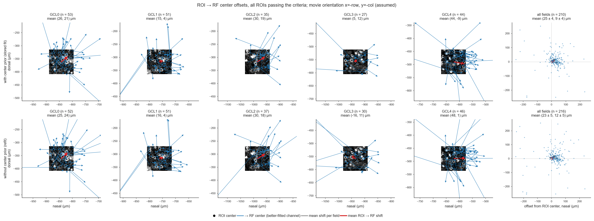
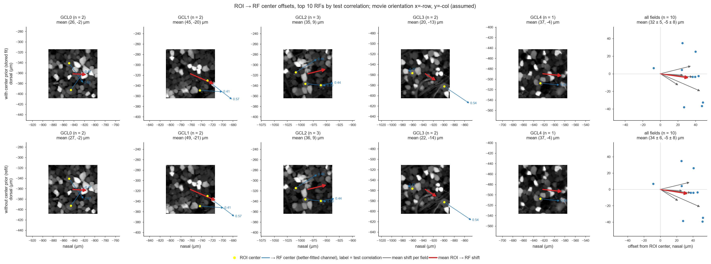
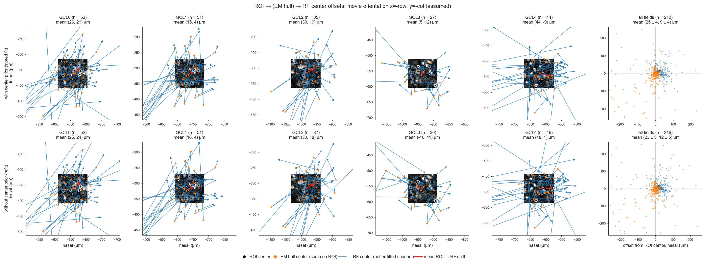
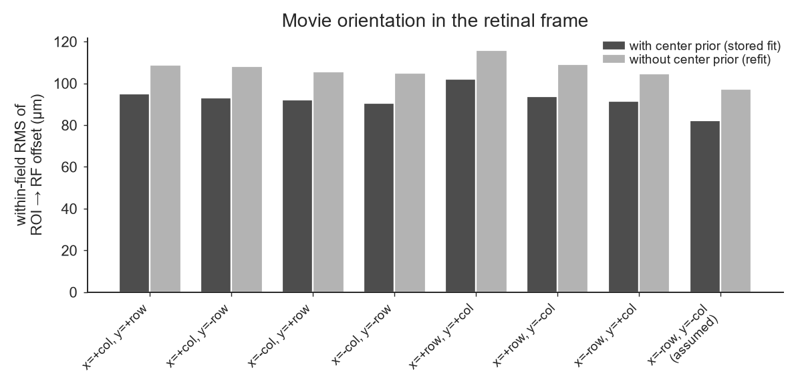
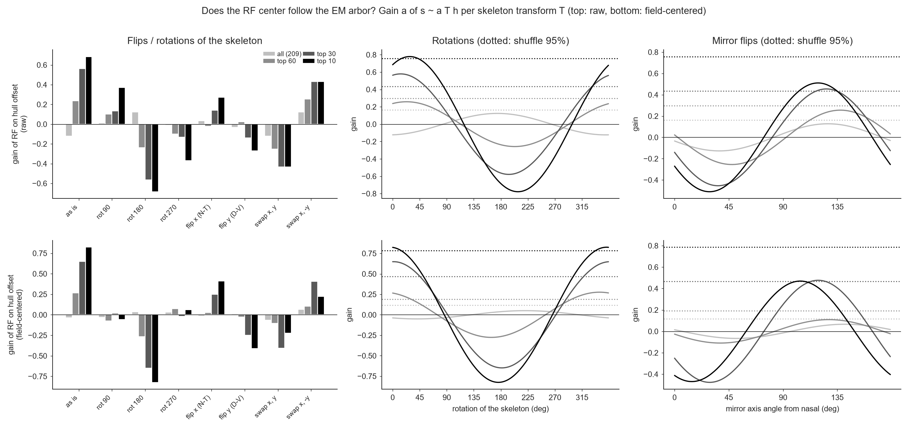
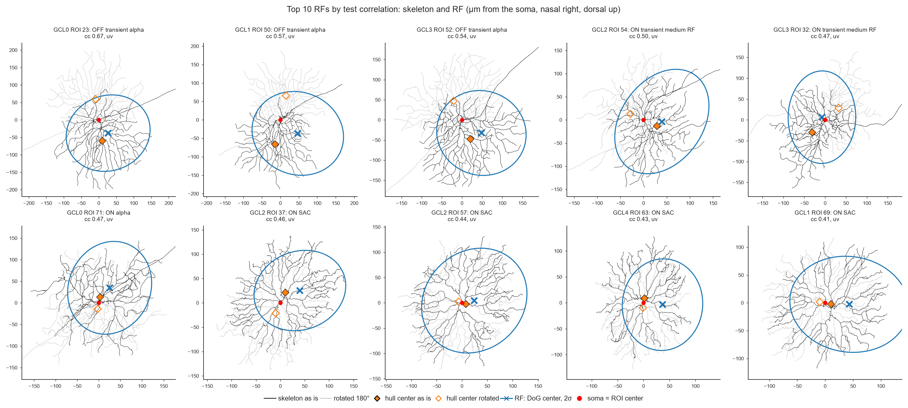
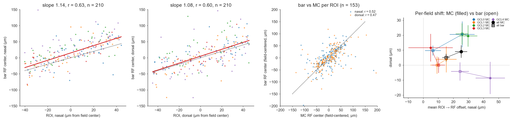
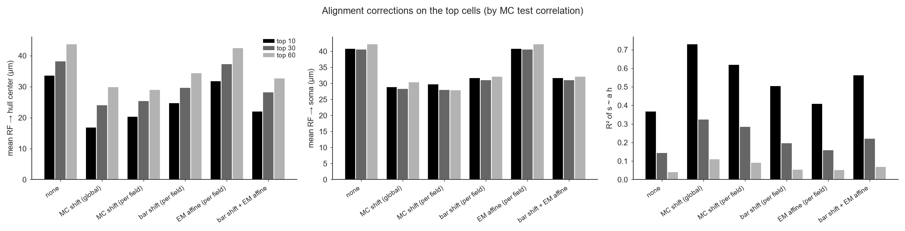
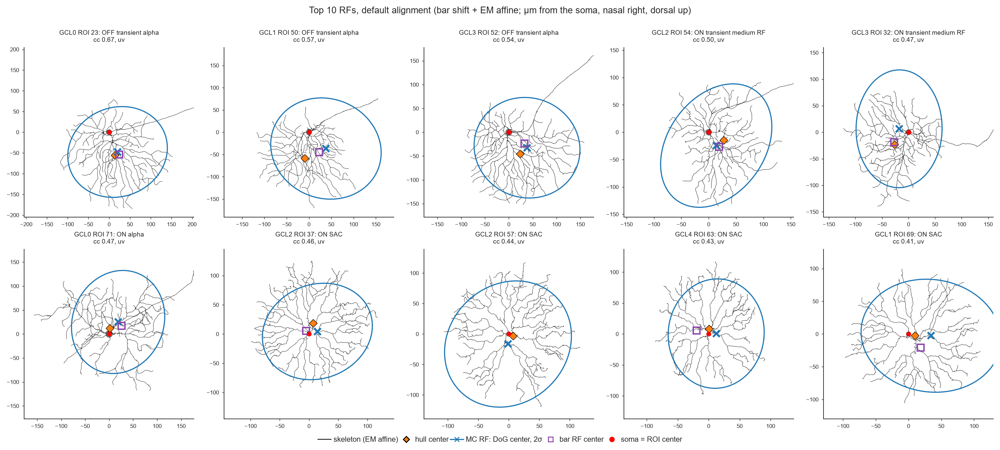

# Alignment of 2p ROIs, mouse-cam RFs and EM morphologies

*Analysis: [`rf_offsets.py`](rf_offsets.py). Correction used by the library: [`rf_alignment.py`](../../../eyewire2_functional_analysis/rf_alignment.py),
stored in `rf_alignment.yaml` in the `data-2p` folder of the shared eyewire2-data download.*

## Summary

- **RFs are shifted nasally relative to the cells.** Mouse-cam (MC) RF centers sit on average **25 ± 4 µm nasal and
  9 ± 4 µm dorsal** of their 2p ROI center (n = 210). For the 10 best RFs, 9 of 10 sit 24–52 µm nasal; the mean is
  (32 ± 5, −5 ± 8) µm.
- **The moving bar sees the same shift, smaller and more precisely.** RF centers estimated independently from the
  moving-bar response timing are shifted by **(15 ± 2, 5 ± 2) µm**. Their per-field shifts follow the MC shifts. Bar
  centers track the ROI positions within a field with slope ≈ 1.1, which confirms the bar method, and they agree with
  the MC centers per ROI (r ≈ 0.5). That agreement also confirms the assumed orientation of the MC movie. The shift is
  therefore a **stimulus vs 2p offset** (same projector for both stimuli), not an artifact of the MC RF fits.
- **The EM skeleton orientation is right.** For the best RFs, the RF follows the arbor (gain 0.65, R² 0.35 for the
  top 30 after removing field shifts; shuffle p = 0.002) only with the skeleton as it is placed. Every flip or
  rotation is worse. A first impression that hull and RF point in opposite directions came from cells with weak RFs.
- **EM vs 2p stretch.** A per-field affine map from EM nuclei to 2p ROIs halves the soma error of the registration
  (≈ 1.8 vs 3–4 µm). In every field it shows ≈ 15 % compression along one diagonal. The skeletons were placed with
  rotation only.
- **New default:** RF positions are corrected by the per-field **bar shift**, and skeletons get the per-field
  **EM affine**. `plot_rf` (`align=True`) and `space_mapping.align_and_place_skel` (`em_affine=True`) apply both;
  pass `False` for the old behavior. For the top 10 cells this reduces the mean RF → arbor-center distance from 34 to
  22 µm.

## Data and definitions

- **ROIs:** all 2p ROIs with an MC RF that pass `qfilt`, whose better-fitted channel has DoG r² ≥ 0.5 and whose DoG
  center is ≥ 2 pixels inside the stimulus window (n = 210 with the stored fits). "Top N" ranks these ROIs by MC test
  correlation (`mc_rf_best_cc`, 0.41–0.67 for the top 10). In almost all of them UV is the better-fitted channel.
- **RF center:** DoG center of the channel with the higher DoG r²
  (`df_eyewire2_roi_level_mc_rf.parquet`). It is mapped to the retinal frame (x = nasal, y = dorsal, µm) with the
  movie centered on the field center and oriented by `receptive_fields.movie_to_retina`.
- **Hull center:** area centroid of the convex hull of the dendritic (non-axon) skeleton nodes. The skeleton is
  rotated into the 2p frame by the registration and its soma is placed on the ROI center, so the ROI → hull leg is
  the soma → arbor-center offset.
- **Center prior:** the stored DoG fits pull the center towards the window center (= field center, SD 100 µm). All
  fits were redone without that prior. The results barely change (mean shift (23 ± 5, 12 ± 5) µm, n = 216), so
  the stored fits are used below.

## 1. ROI → RF offsets

*Per field: field average (ch0) with an arrow from every ROI center to its MC RF center; red: mean shift of the field
from the field center. Panels show the field ± 150 µm, so longer arrows are clipped. Right: all offsets relative to
the ROI center, with the per-field (gray) and overall (red) mean. Top: stored fits; bottom: refit without the center
prior.*

Single-ROI offsets are noisy: after removing each field's mean shift, the remaining spread is 82 µm RMS, comparable
to the field width (94 µm). Only means are reliable. For the best RFs the picture is much more consistent:

*Same for the 10 RFs with the highest test correlation (labels). Panels show the field ± 90 µm.*

| Field | n | MC ROI → RF (µm) | n (bar) | Bar ROI → RF (µm) |
|---|---|---|---|---|
| GCL0 | 53 | (26 ± 8, 21 ± 9) | 54 | (6 ± 5, 10 ± 3) |
| GCL1 | 51 | (15 ± 7, 4 ± 9) | 43 | (9 ± 4, 0 ± 6) |
| GCL2 | 35 | (30 ± 6, 19 ± 7) | 36 | (26 ± 4, 21 ± 7) |
| GCL3 | 27 | (5 ± 15, 12 ± 9) | 26 | (10 ± 4, 0 ± 5) |
| GCL4 | 44 | (44 ± 10, −9 ± 11) | 51 | (24 ± 6, −4 ± 6) |
| all | 210 | (25 ± 4, 9 ± 4) | 210 | (15 ± 2, 5 ± 2) |

*Mean ± SEM, (nasal, dorsal). Bar: section 4. Values in `results/field_shifts_mc_vs_bar.csv` and
`results/rf_offsets_mean_shift.json`.*

### With the EM arbor

*As above, but for EM-matched cells the arrow bends at the hull center (orange). Right: ROI → RF (blue) and ROI → hull
(orange) offsets.*

Over all ROIs the hull center sits (−25, −23) µm from the soma, roughly opposite to the RF shift. Section 3 shows that
this comes from cells with weak RFs and does not indicate a mis-oriented skeleton.

## 2. Orientation of the MC movie

The movie orientation in the retinal frame (`movie_to_retina`: nasal = −row, dorsal = −column) was an untested
assumption. All 8 flips and rotations were compared. With the right one, a shift is the same for all ROIs of a field.
With a wrong one, the RFs are mirrored or rotated about the field center and the offsets scatter more within a field.

*Pooled within-field RMS of the ROI → RF offsets per orientation.*

The assumed orientation has the lowest spread (82 µm, others 91–102 µm), but only by a small margin. Stronger evidence
comes from the bar (section 4), whose direction mapping is documented in the stimulus README and which agrees with the
MC centers per ROI.

## 3. Orientation of the EM skeleton

If the skeleton were mis-oriented, a rotation or mirror flip `T` would bring the hull center closer to the RF. Per
`T`, the RF offset `s` (soma → RF) is regressed on the transformed hull offset `T h` (soma → hull): `s ≈ a T h`. A gain
`a` of 1 means the RF sits on the hull center, 0 unrelated, below 0 opposite. *Field-centered* removes each field's
mean `s` and `h` first, so it tests only whether a cell's RF follows its own arbor. Control: the best gain over all
transforms with `h` shuffled within fields (1000×).

*Gain per transform (left), over all rotations (middle) and mirror axes (right); top raw, bottom field-centered.
Dotted: 95th percentile of the shuffle control.*

| ROIs | Gain as is (R²) | Rotated 180° | Best transform | Shuffle p |
|---|---|---|---|---|
| top 10 | 0.82 (0.83) | −0.82 | rotation 356° | 0.001 |
| top 30 | 0.65 (0.35) | −0.65 | rotation 2° | 0.002 |
| top 60 | 0.27 (0.10) | −0.27 | rotation 344° | 0.004 |
| all 209 | −0.04 (0.00) | 0.04 | mirror 141° | 0.46 |

*Field-centered. All values in `results/skel_orientation_test.csv`.*

The skeleton fits best as it is. Over all ROIs there is no relation between arbor and RF: most MC RFs are too noisy
for that. In the top 30 the mean hull offset is about (0, −5) µm, so the large (−25, −23) µm hull offset over all
ROIs belongs to cells with weak RFs. It only seemed opposed to the RF shift because those cells still carry the
global nasal shift.

*Top 10 cells, soma-centered, uncorrected: skeleton as is (black) and rotated 180° (light gray), their hull centers
(filled / open diamond), MC RF 2σ DoG center ellipse and center (blue). The RF overlaps the arbor as is, but is
offset nasally from both soma and hull.*

## 4. Moving-bar RF centers

The moving bar (8 directions, 1000 µm/s) passes the stimulus center at the same time in every direction (2 s into
each 4 s sweep) and passes an RF at `p` `p · u(d) / v` later. In the retinal frame, script direction `d` moves along
`u(d) = (sin d, cos d)` (see `data-2p/stimuli/README.md`). Per ROI, the responses (mean over 3 repeats, upsampled from
128 to 10 ms) are aligned to a shared template by cross-correlation, and the lags are fitted with
`lag(d) = t0 + p · u(d) / v`, weighted by response amplitude. Latency, ON vs OFF edge and bar size are the same for all
directions and go into `t0`. Peak or centroid timing was too noisy (≈ 160 µm between repeats); template alignment
brings the median repeat-to-repeat SD to 18 µm. Reliable bar centers: `bar_qidx > 0.6` and repeat SD ≤ 50 µm
(210 of 380 ROIs).

*(1, 2) Bar RF center vs ROI position within the field (relative to the field center), nasal and dorsal; red:
linear fit, dotted: identity. (3) Bar vs MC RF center per ROI, both field-centered. (4) Per-field mean ROI → RF
shift from MC (filled) and bar (open) ± SEM; black: all fields.*

- Bar centers follow ROI positions with slope 1.14 (nasal) and 1.08 (dorsal), r ≈ 0.6. The scale of the stimulus
  matches the 2p frame, and the bar estimates are meaningful at the cell level.
- Bar and MC centers agree per ROI after field-centering (r = 0.52 nasal, 0.47 dorsal, n = 153). This independently
  supports the MC movie orientation.
- The bar shows the same direction of shift but about half the size overall. Bar and MC agree well in GCL2 and differ
  most in GCL0 and GCL4. The bar estimates have smaller errors (SEM ≈ 3–6 vs 6–15 µm).

## 5. EM vs 2p stretch

The registration places skeletons with a rotation (plus flip) per field. A per-field affine fit from the EM nucleus
positions to the 2p ROI positions (all 63–88 matched cells of a field) halves the soma error:

| Field | n | Soma RMSE affine | Soma RMSE registration | Singular values of the stretch |
|---|---|---|---|---|
| GCL0 | 88 | 1.9 µm | 4.2 µm | 1.04, 0.86 |
| GCL1 | 78 | 1.8 µm | 3.5 µm | 1.02, 0.86 |
| GCL2 | 63 | 1.9 µm | 4.3 µm | 1.02, 0.82 |
| GCL3 | 66 | 1.6 µm | 4.1 µm | 1.02, 0.81 |
| GCL4 | 81 | 1.7 µm | 3.0 µm | 1.01, 0.88 |

The stretch, i.e. the affine's linear part relative to the registration rotation, is the same in every field: about
15 % compression along one diagonal, none along the other. It may be tissue deformation or a calibration difference
of the 2p scan; either way it is the map from EM to the 2p frame. It moves the hull centers only by a few µm, but
makes the arbor shapes more faithful in the 2p frame.

## 6. Corrections compared

Candidates, all estimated per field from many cells and applied to the top cells. Stimulus shifts are leave-one-out
field means, so a cell never corrects itself.

| Correction | Top 10: RF → hull | RF → soma | R² of s ≈ a h | Top 30: RF → hull | Top 60: RF → hull |
|---|---|---|---|---|---|
| none | 34 µm | 41 µm | 0.37 | 38 µm | 44 µm |
| MC shift (global) | 17 | 29 | 0.73 | 24 | 30 |
| MC shift (per field) | 20 | 30 | 0.62 | 25 | 29 |
| bar shift (per field) | 25 | 32 | 0.50 | 30 | 34 |
| EM affine (per field) | 32 | 41 | 0.41 | 37 | 43 |
| **bar shift + EM affine** | **22** | **32** | **0.56** | **28** | **33** |

*Mean RF → hull distance, RF → soma distance and R² of `s ≈ a h` (raw) per correction for the top 10, 30 and 60
cells. Values in `results/alignment_corrections.csv`.*

The MC-based shifts score best on these metrics, but they are estimated from the same MC RFs that are evaluated. The
**bar shift + EM affine** combination was chosen as the default because both parts come from data independent of the
MC RFs: the bar responses and the nucleus positions. With 10–60 cells, the differences between the shift-based options
are not decisive.

## 7. Default alignment

`rf_offsets.py` writes `rf_alignment.yaml` (in `data-2p`) with, per field, the full-field bar shift (not
leave-one-out) and the EM stretch:

| Field | Stimulus shift (nasal, dorsal) | n |
|---|---|---|
| GCL0 | (6.5, 9.7) µm | 54 |
| GCL1 | (9.1, 0.0) µm | 43 |
| GCL2 | (25.8, 20.9) µm | 36 |
| GCL3 | (10.2, 0.0) µm | 26 |
| GCL4 | (24.4, −4.2) µm | 51 |

- `plot_rf.srf_retina`, `dog_ellipse`, `draw_dog`, `rf_radius` and `plot_srf_on_morph` subtract the stimulus shift
  from RF positions (`align=True`).
- `space_mapping.align_and_place_skel` applies the EM stretch about the soma after the rotation (`em_affine=True`).
  This affects every skeleton placed with it, including the interactive explorer and the retinal-outline tutorial.
- All estimation steps in `rf_offsets.py` run uncorrected (`align=False`, `em_affine=False`).

*Top 10 cells drawn with the library defaults: skeleton with the EM stretch and its hull center (orange), corrected MC
RF (blue ellipse and cross), corrected bar RF center (purple), soma (red).*

## Caveats and open points

- Most MC RFs are too noisy to locate single cells: the arbor–RF relation exists only for the best ~30–60 RFs. The
  bar estimates are more precise per ROI but are only available for ROIs that respond well to the bar.
- The bar and MC shifts disagree in size (15 vs 25 µm nasal overall, most in GCL0 and GCL4). Possible reasons: the
  remaining center prior / window effects in the MC fits, and the different spatial weighting of the two stimuli
  (bar: response-weighted along each direction). The bar shift is the more conservative choice.
- The stimulus shift is a translation per field. Stimulus scale and rotation look correct (bar slope ≈ 1.1, MC
  orientation test), but a per-field rotation or scale of the stimulus is not identifiable within a 94 µm field.
- The ranking of corrections rests on 10–60 cells, and the "top" set is chosen by MC test correlation, which was used
  to select the penalty and is optimistic.
